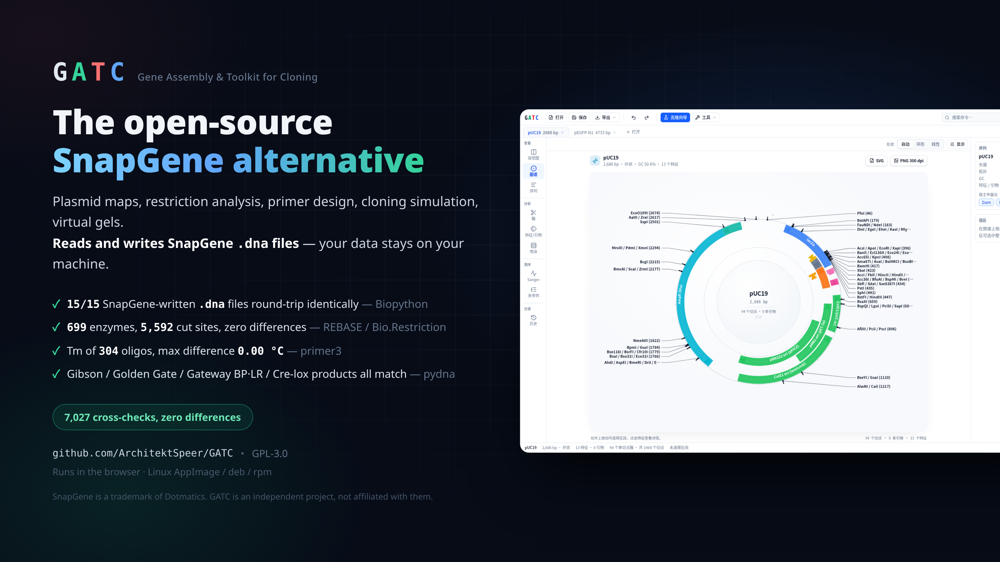
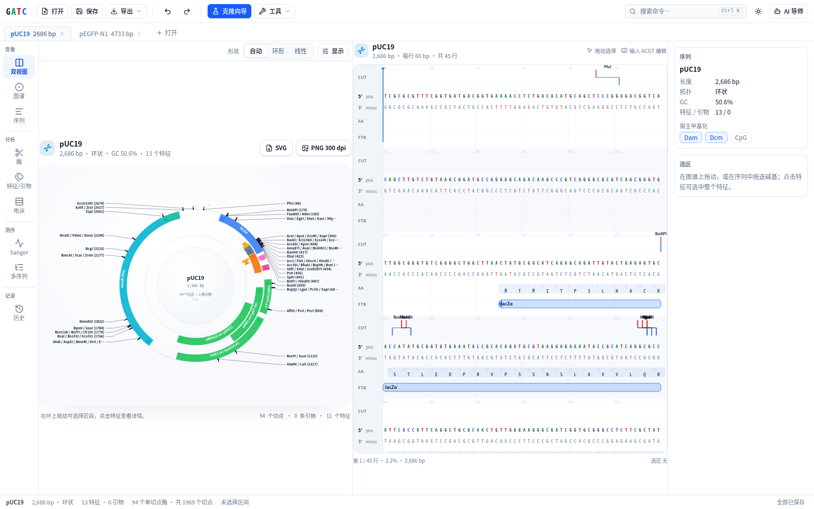
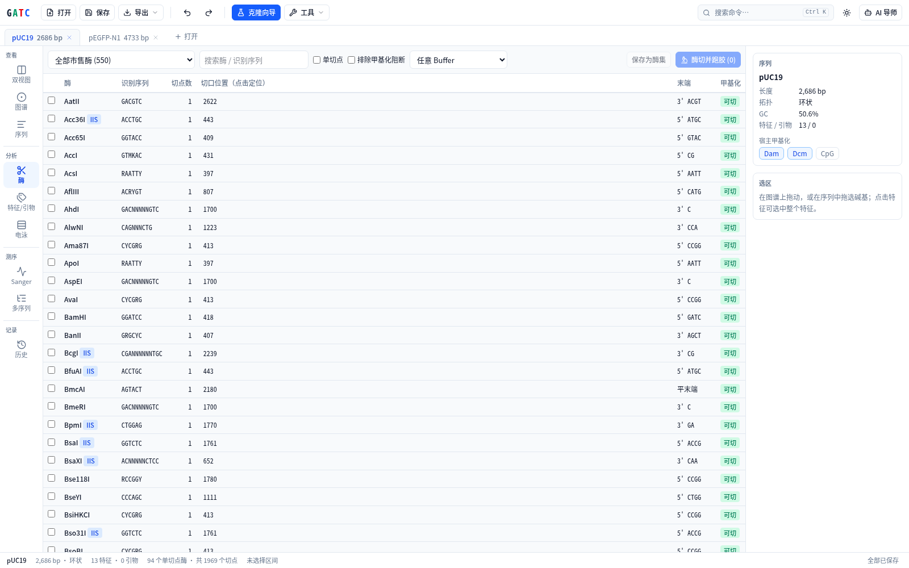
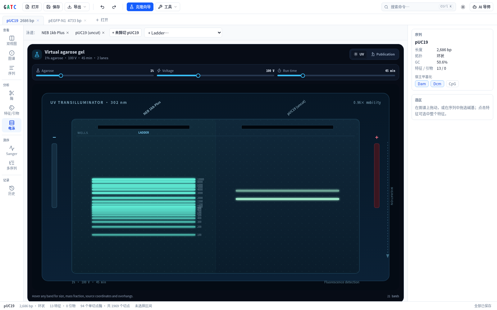
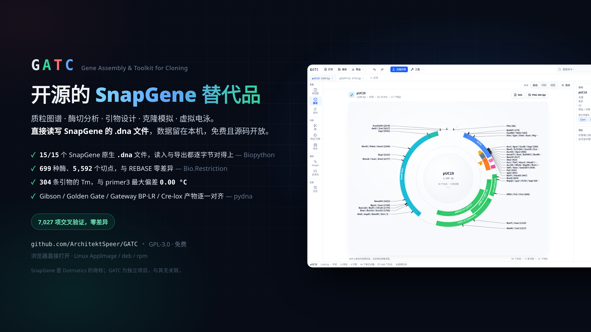

# GATC



[](https://github.com/ArchitektSpeer/GATC/actions/workflows/ci.yml)
[](LICENSE)
[](https://architektspeer.github.io/GATC/)

**G**ene **A**ssembly & **T**oolkit for **C**loning — the four DNA bases, and what the tool does.

An open-source, offline-first molecular biology workbench: plasmid maps, sequence editing,
restriction and cloning simulation, primer design, Sanger alignment, virtual gels and a
bring-your-own-key AI assistant. One codebase builds both a static web app (PWA) and a Tauri
desktop app.

[English](#english) · [中文](#中文)

---

## English

### Install

**In the browser — nothing to install:** <https://architektspeer.github.io/GATC/>

It is a PWA, so it also works offline once loaded and can be installed from the address bar.
Sequences are parsed in your browser and never leave the machine; there is no account and no
server to upload to.

**On the desktop:** download from [Releases](https://github.com/ArchitektSpeer/GATC/releases).

| | File | Install |
|---|---|---|
| Any Linux | `GATC_0.1.0_amd64.AppImage` | `chmod +x` it and run it |
| Debian, Ubuntu | `GATC_0.1.0_amd64.deb` | `sudo apt install ./GATC_0.1.0_amd64.deb` |
| Fedora, RHEL | `GATC-0.1.0-1.x86_64.rpm` | `sudo dnf install ./GATC-0.1.0-1.x86_64.rpm` |

Only Linux packages are published so far. Windows and macOS builds come from the same source —
`npm run tauri:build` on that platform produces them — they are simply not built here yet.

### Development

```bash
npm install
npm run dev          # http://localhost:5173
npm run build        # production build → dist/ (deployable as a static site)
npm run tauri:dev    # desktop app (needs Rust and a system WebView)
npm run tauri:build
```

It opens with two real NCBI sequences, **pUC19 (L09137)** and **pEGFP-N1 (U55762)**, plus a
simulated Sanger read covering EGFP. Drop in `.dna`, `.prot`, `.gb`, `.ape`, `.fasta`, `.embl`,
`.gff`, `.ab1` or `.fastq` files, or fetch by accession from NCBI.

Shortcuts: `Ctrl/Cmd+K` command palette, `Ctrl/Cmd+F` find, `Ctrl/Cmd+Z` undo,
`Ctrl/Cmd+Shift+Z` redo, `Ctrl/Cmd+O` open.

### What it does

| Area | Capabilities |
|---|---|
| Saving | `.gatc` project files (all documents, raw sequencing data and workspace, versioned with migrations); unsaved-change marker and close prompt; automatic local backup while there are unsaved changes (IndexedDB in the browser, app data directory on desktop, atomic writes with rotation) and recovery after a crash — see [docs/COMPATIBILITY.md](docs/COMPATIBILITY.md) |
| Files | Read and write SnapGene `.dna` (primers, methylation, construction history tree, multi-segment features); read GenBank, ApE, Vector NTI, Benchling, FASTA, EMBL, GFF, DNASTAR `.seq`, Serial Cloner `.xdna`, Geneious, SBOL; protein `.prot`, GenPept and protein FASTA; FASTQ reads; fetch from NCBI by accession, or by accession plus a coordinate range so a gene and its flanks come down without the whole chromosome; export GenBank (joined multi-segment features, ApE colours), FASTA and JSON; export maps as SVG, 300 dpi PNG or vector PDF, and print maps and sequences |
| Views | Circular and linear maps (multi-track features, collision-avoiding leader lines, multi-segment features, ORFs, GC curve, display options), virtualised double-stranded sequence (staggered cut marks, primers, CDS translation), protein view (property colouring, MW and pI), enzyme list, features/primers/ORFs, virtual gel, Sanger traces with coverage, multiple alignment, replayable cloning history tree; light, dark and publication themes |
| Editing | Base-level editing, add/edit/delete features and primers (all undoable), ORF to CDS, auto-annotation, reverse complement, set origin, circular/linear toggle |
| Finding | IUPAC degenerate patterns, mismatch tolerance, both strands, matches across the origin, six-frame protein search; primer library binding-site search across all open sequences (mismatches allowed, 3′ end must match) |
| Enzymes | 580+ commercial enzymes and a 3000+ enzyme database with isoschizomer lookup, preset and custom enzyme sets, scanning across the origin, Dam/Dcm/CpG methylation blocking, NEB buffer recommendation for double digests with star-activity warnings |
| Vector library | 32 common vectors bundled as GenBank records and opened offline — cloning, bacterial expression, mammalian, yeast, plant and broad-host — plus the 105 SEVA standard vectors catalogued by accession and fetched on demand. Every entry names an authoritative GenBank accession |
| Interchange | The construction history exports as an [OpenCloning](https://github.com/OpenCloning/OpenCloning_LinkML) cloning strategy (LinkML JSON, schema 0.4.8) and reads back in, and as a runnable pydna script. The script rebuilds each product from its parents and asserts it against the sequence GATC recorded, so running it is the check; a step pydna cannot express is written as the recorded sequence with a TODO rather than as code that would lie |
| Genome engineering | CRISPR target scanning for SpCas9, SaCas9 and Cas12a with the cut position each one's own paper gives (and a flag when that position is published as a range), guide checks for GC, U6 terminators and homopolymers, off-target search across the sequences that are open — stated as such, never as a genome-wide result — and a handoff to the annealing tool. Homologous recombination at a locus: homology arms taken from the flanks, donor primers that carry them, the recombinant locus itself, and check primers outside the arms with both diagnostic PCR sizes worked out |
| Modular cloning | The plant common syntax of Patron et al. 2015 (twelve fusion sites, read from the paper's own figure) and the Yeast Toolkit part types, with a check that a part really presents the overhangs its position calls for, a check that the chosen positions chain and close, primer design that turns any stretch of sequence into a part for a position, and combinatorial Golden Gate — one product per combination of the candidates in each position |
| Oligo annealing | Hybridise two ordered oligos into a short duplex with defined ends, or work backwards from the insert and the ends it must present and get the two oligos to order — how sgRNA spacers, linkers, adaptors and tags are actually cloned. Takes the overhangs straight off a digested vector, and the product feeds the ligation and Golden Gate wizards |
| Annotation | Local auto-annotation from 300+ common parts (exact and tolerant DNA matching, CDS parts also matched by protein translation), six-frame ORFs with MW and pI |
| Cloning | Single and double digest ligation (compatible ends, fill-in/chew-back, dephosphorylation), insert fragment, Gibson / NEBuilder HiFi / In-Fusion, Golden Gate (fidelity score, internal-site warnings), Gateway BP/LR/MultiSite LR, TA / GC / TOPO (TA, blunt, directional), LIC, Cre/lox and Flp/FRT recombination (excision, inversion, integration), PCR, fusion PCR, site-directed mutagenesis (QuikChange and Q5 back-to-back, with silent restriction-site suggestions) |
| Primers | SantaLucia 1998 nearest-neighbour with Owczarzy 2008 Mg²⁺/dNTP salt correction (Tm within 0.01 °C of 46 reference primers), SantaLucia & Hicks 2004 dynamic-programming hairpin and dimer ΔG (mean error 0.3–0.5 kcal/mol), restriction-site and homology-arm primer design, a primer library that persists across sessions |
| Alignment | Sanger `.ab1` (Mott trimming, heterozygous double peaks, alignment across the origin, amino-acid impact, multi-read consensus and coverage), FASTQ read alignment, multiple sequence alignment (guide tree plus progressive profile alignment, DNA and protein BLOSUM62), pairwise global/local/semi-global alignment |
| Protein | Back-translation and codon optimisation for 8 hosts (optionally avoiding named restriction sites), CAI |
| Gels | 36 commercial ladders, 0.5–3% agarose, voltage and run time, supercoiled/nicked/linear conformations, mass-weighted band intensity |
| Experiment record | One click turns the open workspace into a lab record: construct, features, primers, a PCR programme per polymerase class, the digest recipe with the buffer the enzyme data recommends, gel lanes, the lineage and the sequence — as Markdown, or as a printable web page with the map embedded. Every rule of thumb says where it comes from |
| AI | Bring your own key: OpenAI, Anthropic, DeepSeek, Gemini or any compatible endpoint; the key stays in the browser; compressed plasmid context; structured action cards you can run with one click |

### Screens

| Dual view — map and sequence side by side | Restriction analysis |
|---|---|
|  |  |



### Architecture

```
src/
├── types/schema.ts          the single data contract
├── modules/                 six isolated modules (they import the schema and open-source libraries, never each other)
│   ├── io-adapter/          @teselagen/bio-parsers plus a SnapGene TLV enrichment pass
│   ├── seq-engine/          digestion, ORFs, edit-coordinate bookkeeping, auto-annotation
│   ├── cloning-primer/      thermodynamics and every cloning simulation
│   ├── alignment-gel/       ABIF parsing, alignment, virtual gel
│   ├── canvas-ui/           purely controlled visual components
│   └── ai-copilot/          BYOK adapters and the sidebar
└── app/                     integration: zustand+zundo store, Web Worker pool, workbench
```

Heavy computations run in a Web Worker pool through `src/app/bio.worker.ts`, so the main thread
is never blocked.

### MCP server

The deterministic sequence tools (read files, cut sites, primer design, PCR/Gibson/Golden Gate
simulation, mutagenesis, ORFs, auto-annotation, Sanger alignment, write files) are available to
other agents as a local MCP server:

```bash
npm run mcp:build
claude mcp add gatc -- node "$PWD/dist-mcp/gatc-mcp.mjs" --root ~/plasmids
```

File access is confined to `--root`; only `write_sequence_file` writes, and it does not
overwrite by default. See [docs/MCP.md](docs/MCP.md) for the tool list and coordinate
conventions.

### Verification

```bash
npm run typecheck                     # tsc --noEmit
npm run test                          # vitest: unit, cross-module and real-file tests
npm run build && npx vite preview &   # then:
node scripts/e2e.mjs e2e-report       # Playwright walkthrough with screenshots and report.json
npm run check:session                 # browser run: edit → force quit → recover → save → reopen
npm run mcp:build && node scripts/mcp-check.mjs   # start the MCP server over stdio and call it
node scripts/make-audit-bundle.mjs    # write AUDIT_BUNDLE.md for an external review
npm run crosscheck                    # compare with Biopython, REBASE, primer3 and pydna (needs Python 3)
```

`npm run crosscheck` runs every computation against an independent implementation, using `.dna`
files written by SnapGene itself:

| Stage | GATC | Reference |
|---|---|---|
| 1 | `.dna` read and write | Biopython's SnapGene parser, both directions |
| 2 | Cut sites, primer Tm, CDS translation | REBASE, primer3, the protein stored in the file |
| 3 | Digests, PCR, restriction cloning; Gibson, Golden Gate | pydna; known answers |
| 4 | Gateway BP/LR; Cre/lox | pydna `gateway_assembly`, `recombinase_assembly` |
| 5 | Pairwise alignment; TA/TOPO/LIC/GC; mutagenesis; gel read-back | Biopython `PairwiseAligner`; known answers; Biopython translation and primer3 |
| 6 | The pydna script GATC generates | pydna itself: the script is run, and every step it rebuilds is asserted against GATC's own product |

Results, and the defects this found and fixed, are in [docs/CROSSCHECK.md](docs/CROSSCHECK.md).

### Licence

Copyright (C) 2026 Xu Zhonghe

This program is free software: you can redistribute it and/or modify it under the terms of the
GNU General Public License as published by the Free Software Foundation, either version 3 of
the License, or (at your option) any later version. It is distributed in the hope that it will
be useful, but **WITHOUT ANY WARRANTY**. See [LICENSE](LICENSE) for the full terms.

SPDX-License-Identifier: `GPL-3.0-or-later`

A build also contains third-party packages under their own permissive licences, reproduced in
[THIRD-PARTY-NOTICES.md](THIRD-PARTY-NOTICES.md). To cite GATC, see [CITATION.cff](CITATION.cff).

---

## 中文



GATC 是开源、离线优先的分子生物学工作台：质粒图谱、序列编辑、酶切与克隆模拟、引物设计、
Sanger 比对、虚拟电泳，以及自带密钥（BYOK）的 AI 助手。一套代码同时构建纯静态 Web/PWA 与
Tauri 桌面客户端。

### 安装

**浏览器直接用，什么都不用装：**<https://architektspeer.github.io/GATC/>

这是一个 PWA，加载过一次之后可离线使用，也能从地址栏安装到桌面。序列在你自己的浏览器里解析，
不会离开本机；没有账号，也没有服务器可上传。

**桌面端：**到 [Releases](https://github.com/ArchitektSpeer/GATC/releases) 下载。

| 系统 | 文件 | 安装方式 |
|---|---|---|
| 任意 Linux | `GATC_0.1.0_amd64.AppImage` | `chmod +x` 后直接运行 |
| Debian、Ubuntu | `GATC_0.1.0_amd64.deb` | `sudo apt install ./GATC_0.1.0_amd64.deb` |
| Fedora、RHEL | `GATC-0.1.0-1.x86_64.rpm` | `sudo dnf install ./GATC-0.1.0-1.x86_64.rpm` |

目前只发布了 Linux 包。Windows 与 macOS 用的是同一套源码，在对应系统上跑 `npm run tauri:build`
就能构建出来，只是这里还没有构建产物。

### 开发

```bash
npm install
npm run dev          # http://localhost:5173
npm run build        # 生产构建 → dist/（可直接作为静态站点部署）
npm run tauri:dev    # 桌面客户端（需 Rust 与系统 WebView）
npm run tauri:build
```

打开后自动加载 NCBI 真实序列 **pUC19 (L09137)** 与 **pEGFP-N1 (U55762)**，以及一条覆盖 EGFP
的模拟 Sanger 读长。可直接拖入 `.dna`、`.prot`、`.gb`、`.ape`、`.fasta`、`.embl`、`.gff`、
`.ab1`、`.fastq` 等文件，或按登录号从 NCBI 导入。

快捷键：`Ctrl/Cmd+K` 命令面板、`Ctrl/Cmd+F` 查找、`Ctrl/Cmd+Z` 撤销、`Ctrl/Cmd+Shift+Z` 重做、
`Ctrl/Cmd+O` 打开文件。

### 功能

| 领域 | 能力 |
|---|---|
| 保存 | `.gatc` 项目文件（全部文档 + 原始测序数据 + 工作区，带版本号与迁移）；未保存标记与关闭提醒；有未保存修改时自动备份到本机（浏览器用 IndexedDB，桌面用应用数据目录，原子写入与轮换备份），异常退出后可恢复。见 [docs/COMPATIBILITY.md](docs/COMPATIBILITY.md) |
| 文件 | 读写 SnapGene `.dna`（含引物、甲基化、构建历史树、多段特征）；读取 GenBank、ApE、Vector NTI、Benchling、FASTA、EMBL、GFF、DNASTAR `.seq`、Serial Cloner `.xdna`、Geneious、SBOL；蛋白文件 `.prot`、GenPept、蛋白 FASTA；FASTQ 读长；按登录号从 NCBI 导入，也可只取某段坐标区间（如基因及其上下游 1 kb），不必下载整条染色体；导出 GenBank（join 多段特征、ApE 颜色）、FASTA、JSON；图谱导出 SVG、300 dpi PNG、矢量 PDF，图谱与序列可直接打印 |
| 视图 | 环形与线性图谱（多轨道特征、防碰撞引线、多段特征、ORF、GC 曲线、可配置显示项）、虚拟滚动双链序列（酶切阶梯切口、引物、CDS 翻译）、蛋白序列视图（按理化性质着色、分子量与 pI）、酶列表、特征/引物/ORF、虚拟电泳、Sanger 峰图与覆盖度、多序列比对、可重放的克隆历史树；浅色/深色/出版白底主题 |
| 编辑 | 碱基级编辑，特征与引物的添加、编辑、删除（均可撤销），ORF 一键转 CDS，自动注释，反向互补，重设原点，环状/线性切换 |
| 查找 | IUPAC 简并模式、允许错配、双链与跨原点命中、6 框蛋白查找；引物库可在所有已打开序列中查找结合位点（允许错配，3′ 端须完全匹配） |
| 酶 | 580+ 种市售酶、3000+ 酶数据库（含同裂酶查询），预设与自定义酶集，跨原点扫描，Dam/Dcm/CpG 甲基化阻断判定，双酶切 NEB 缓冲液推荐与星号活性提示 |
| 载体库 | 内置 32 个常用载体的 GenBank 记录，离线即开——通用克隆、原核表达、哺乳动物、酵母、植物与广宿主——另有 105 个 SEVA 标准载体按登录号收录、按需获取。每个条目都对应一条权威 GenBank 记录 |
| 互通 | 构建历史可导出为 [OpenCloning](https://github.com/OpenCloning/OpenCloning_LinkML) 克隆策略（LinkML JSON，schema 0.4.8）并能读回，也可导出为可运行的 pydna 脚本。脚本会从亲本重建每个产物并与 GATC 记录的序列断言比对，跑一遍就是验证；pydna 无法表达的步骤按记录的序列给出并标注 TODO，不生成"看起来能跑但结果是错的"代码 |
| 基因组编辑 | CRISPR 靶点扫描（SpCas9、SaCas9、Cas12a，切点按各自原始文献计算，文献给范围的会标明是近似值）；间隔序列的 GC、U6 终止子、连续碱基检查；在已打开的序列中查脱靶（明确声明不是全基因组搜索）；一键把间隔序列交给退火工具。同源重组敲除/敲入：从位点两翼取同源臂、生成带臂的供体扩增引物、重组后的位点序列，以及落在同源臂之外的鉴定引物与野生型/重组型两种产物大小 |
| 组合克隆 | 内置 Patron 2015 植物通用语法（12 个接头，直接读自论文图表）与酵母工具箱 YTK 元件类型；校验元件实际切出的接头是否与所在位置相符、所选位置能否首尾相接并环化；可把任意一段序列设计成某个位置的元件（domestication）；并支持 N×M 组合装配，每种组合生成一个产物 |
| 寡核苷酸退火 | 两条引物退火成带末端的短双链片段；也可反过来，给定要插入的序列和需要的末端，直接算出该订哪两条引物——sgRNA 间隔序列、linker、接头、标签都这么连。末端可从已酶切的载体直接取，产物可送入酶切连接与 Golden Gate 向导 |
| 注释 | 300+ 常用元件的本地自动注释（DNA 精确与容错匹配，CDS 元件可按蛋白翻译匹配），6 框 ORF 与分子量/等电点 |
| 克隆 | 单双酶切连接（同尾酶、补平/削平、去磷酸化）、插入片段、Gibson / NEBuilder HiFi / In-Fusion、Golden Gate（保真度评分、内部位点预警）、Gateway BP/LR/MultiSite LR、TA / GC / TOPO（TA、平端、定向）、LIC、Cre/lox 与 Flp/FRT 重组（切除、倒位、整合）、PCR、融合 PCR、定点突变（QuikChange 与 Q5 背靠背，附静默酶切位点推荐） |
| 引物 | SantaLucia 1998 最邻近 + Owczarzy 2008 Mg²⁺/dNTP 盐校正（46 条参考引物 Tm 误差 < 0.01 °C），SantaLucia & Hicks 2004 动态规划发夹与二聚体 ΔG（平均误差 0.3–0.5 kcal/mol），酶切位点加保护碱基、同源臂引物设计，跨会话保存的引物库 |
| 比对 | Sanger `.ab1`（Mott 修剪、杂合双峰、跨原点比对、氨基酸影响、多读长一致性与覆盖度）、FASTQ 读长比对、多序列比对（引导树 + 渐进式 profile 比对，DNA 与蛋白 BLOSUM62）、双序列全局/局部/半全局比对 |
| 蛋白 | 反向翻译与 8 种宿主密码子优化（可避开指定酶切位点）、CAI 计算 |
| 电泳 | 36 种商业 Ladder、0.5–3% 胶浓度、电压与时间、超螺旋/开环/线性构象、按质量计算亮度 |
| 实验记录 | 一键把当前工作区导出成实验记录：构建体、特征、引物、按聚合酶分列的 PCR 程序、按酶活性数据推荐缓冲液的酶切体系、电泳泳道、构建谱系与序列——可导出 Markdown，或导出含图谱、可直接打印/存 PDF 的网页。每个经验公式都注明出处 |
| AI | 自带密钥：OpenAI、Anthropic、DeepSeek、Gemini 或任意兼容端点；密钥仅存于本地浏览器；质粒上下文压缩；可一键执行的结构化动作卡片 |

### 界面

| 双视图：图谱与序列并排 | 酶切分析 |
|---|---|
|  |  |


### 架构

```
src/
├── types/schema.ts          全局唯一数据契约
├── modules/                 6 个互不引用的独立模块（只依赖 schema 与开源库）
│   ├── io-adapter/          @teselagen/bio-parsers + SnapGene TLV 增强解析
│   ├── seq-engine/          酶切、ORF、编辑坐标联动、自动注释
│   ├── cloning-primer/      热力学与全部克隆模拟
│   ├── alignment-gel/       ABIF 解析、比对、虚拟电泳
│   ├── canvas-ui/           纯受控可视化组件
│   └── ai-copilot/          BYOK 适配器与侧边栏
└── app/                     集成层：zustand+zundo 状态总线、Web Worker 池、工作台
```

计算密集的函数通过 `src/app/bio.worker.ts` 在 Web Worker 池中执行，主线程不被阻塞。

### MCP 接口

GATC 的确定性序列工具（读文件、酶切位点、引物设计、PCR/Gibson/Golden Gate 模拟、定点突变、
ORF、自动注释、Sanger 比对、写文件）可作为本地 MCP 服务器供其他 Agent 调用：

```bash
npm run mcp:build
claude mcp add gatc -- node "$PWD/dist-mcp/gatc-mcp.mjs" --root ~/plasmids
```

文件访问限制在 `--root` 指定的目录内；只有 `write_sequence_file` 会写文件，且默认不覆盖已有
文件。工具列表、坐标约定与各客户端配置见 [docs/MCP.md](docs/MCP.md)。

### 验证

```bash
npm run typecheck                     # tsc --noEmit
npm run test                          # vitest：单元、跨模块与真实文件测试
npm run build && npx vite preview &   # 然后：
node scripts/e2e.mjs e2e-report       # Playwright 浏览器走查，输出截图与 report.json
npm run check:session                 # 浏览器走查：编辑 → 强制关闭 → 恢复 → 保存 → 重新打开
npm run mcp:build && node scripts/mcp-check.mjs   # 以 stdio 启动 MCP 服务器并调用工具
node scripts/make-audit-bundle.mjs    # 生成 AUDIT_BUNDLE.md 供外部审计
npm run crosscheck                    # 与 Biopython / REBASE / primer3 / pydna 交叉验证（需 Python 3）
```

`npm run crosscheck` 用 **SnapGene 自身生成的真实 `.dna` 文件**，把每一项计算与独立实现逐项对比：

| 阶段 | GATC | 参考实现 |
|---|---|---|
| 1 | `.dna` 读写 | Biopython 的 SnapGene 解析器（双向） |
| 2 | 酶切位点、引物 Tm、CDS 翻译 | REBASE、primer3、文件内自带的蛋白序列 |
| 3 | 酶切片段、PCR、酶切连接；Gibson、Golden Gate | pydna；已知答案 |
| 4 | Gateway BP/LR；Cre/lox | pydna 的 `gateway_assembly`、`recombinase_assembly` |
| 5 | 双序列比对；TA/TOPO/LIC/GC；定点突变；电泳读数 | Biopython `PairwiseAligner`；已知答案；Biopython 翻译与 primer3 |

结果，以及据此发现并修复的缺陷，记录在 [docs/CROSSCHECK.md](docs/CROSSCHECK.md)。

### 许可

版权所有 (C) 2026 Xu Zhonghe

本程序是自由软件：你可以依据自由软件基金会发布的 GNU 通用公共许可证第 3 版，或（按你的选择）
任何更新的版本，重新发布和/或修改它。本程序的发布是希望它有用，但**不提供任何担保**。完整条款
见 [LICENSE](LICENSE)。

SPDX-License-Identifier: `GPL-3.0-or-later`

发行包中还包含以各自宽松许可证分发的第三方依赖，许可证全文见
[THIRD-PARTY-NOTICES.md](THIRD-PARTY-NOTICES.md)。引用本项目请参照 [CITATION.cff](CITATION.cff)。

---

## Acknowledgements / 致谢与第三方资料

GATC builds on other open-source work in three different ways. They are listed separately because
the obligations differ, and versions are recorded so that what was used can be checked.

GATC 对其他开源项目的使用分三类，义务各不相同，因此分开列出，并记录具体版本以便核对：**随发行包一起分发的依赖**（必须附带许可证全文）、**参考过格式文档但独立实现的部分**（未复制代码）、**仅作为交叉验证参照、从未进入构建的工具**。

**Bundled in a GATC build.** These packages ship inside the application, and their licences
require the copyright and permission notice to travel with it.
[THIRD-PARTY-NOTICES.md](THIRD-PARTY-NOTICES.md) reproduces every one of them in full,
regenerated by `node scripts/gen-third-party-notices.mjs`, and the file is installed alongside the
binary. The two GATC leans on most are
[TeselaGen tg-oss](https://github.com/TeselaGen/tg-oss) (MIT — `@teselagen/bio-parsers` 0.4.38,
`@teselagen/range-utils` 0.3.20, `@teselagen/sequence-utils` 0.3.42) and
[SeqViz](https://github.com/Lattice-Automation/seqviz) 3.10.25 (MIT).

**Consulted, then implemented independently.** No code was copied from these projects. They
document the SnapGene `.dna` and Vector NTI `.xdna` binary layouts; the parsers in
`src/modules/io-adapter/` were written against that documented format:
[SnapGeneReader](https://github.com/Edinburgh-Genome-Foundry/SnapGeneReader) v0.1.23 (MIT),
[autosnapgene](https://github.com/kalekundert/autosnapgene) (MIT, commit `8917853`),
[snapgene-deepreader](https://github.com/karlYei/snapgene-deepreader) (MIT, commit `d4bf701`),
Biopython `SnapGeneIO` and `XdnaIO` (Biopython License) and the Xdna format notes published by
incenp.org. A file format is a fact rather than an expression of it, so this is attribution for
honesty rather than a licence obligation.

**Catalogue data.** The SEVA half of the built-in vector library is a name-to-accession
mapping taken from [OpenCloning](https://github.com/OpenCloning/OpenCloning_backend) (MIT,
`packages/opencloning/src/opencloning/catalogs/seva.tsv`, read 2026-10-27); only the 105 entries
that name a GenBank accession are used. The sequences themselves are not redistributed — GATC
fetches them from NCBI, as OpenCloning does.

**Deliberately not implemented: Addgene and iGEM one-click import.** Both were on the roadmap and
both were checked, in October 2026, before being dropped. Addgene's sequence files now sit behind a
login, and its data API requires an account, so a browser-only application cannot fetch them for
you; `media.addgene.org` does send `Access-Control-Allow-Origin: *`, so a sequence file you have
already downloaded opens normally. The iGEM Registry has a clean JSON API
(`api.registry.igem.org/v1/parts?name=BBa_…`, parts carry an SPDX licence, usually CC-BY-4.0) but
it allows cross-origin requests only from `*.igem.org`, so it too is unreachable without a proxy —
and running one would break the no-server promise. Both would work the moment either service opens
up, or behind a proxy the user runs themselves. NCBI, by contrast, allows cross-origin requests,
which is why fetching by accession and by coordinate range is built in.

**刻意没做：Addgene 与 iGEM 一键导入。** 这两项原在路线图上，2026 年 10 月逐一核实后放弃。Addgene
的序列文件现在需要登录，其数据 API 也要账号，纯前端应用无法代用户取；但 `media.addgene.org`
带 `Access-Control-Allow-Origin: *`，已经下载到本地的序列文件可以正常打开。iGEM Registry 有干净的
JSON 接口，零件自带 SPDX 许可证（多为 CC-BY-4.0），但只允许 `*.igem.org` 跨域，同样要架代理才能用，
而架代理就违背了「不需要服务器」这一条。两者只要哪天放开，或用户自己架了代理，随时可以接上。
NCBI 允许跨域，所以按登录号、按坐标区间取序列是内置的。

**Used only as an independent reference.** None of this enters a GATC build; `npm run crosscheck`
checks GATC's output against it, and the results are in [docs/CROSSCHECK.md](docs/CROSSCHECK.md):
[Biopython](https://biopython.org/) 1.88 (Biopython License),
[primer3-py](https://github.com/libnano/primer3-py) 2.4.0 (GPL-2.0),
[pydna](https://github.com/pydna-group/pydna) 5.5.16 (BSD-3-Clause).
`test-data/primer3-reference.json` holds values produced by
[Primer3](https://github.com/primer3-org/primer3) (GPL-2.0) and is used for accuracy regression;
those numbers are measurements rather than Primer3 code, and no Primer3 source is present here.

**Data and literature.** Enzyme definitions and cut positions come from REBASE, read through
Biopython's restriction tables. REBASE is free for academic use and asks to be cited:

> Roberts, R.J., Vincze, T., Posfai, J., Macelis, D. (2023) REBASE: a database for DNA restriction
> and modification: enzymes, genes and genomes. *Nucleic Acids Research* **51**: D629–D630.

Thermodynamics follow SantaLucia (1998), SantaLucia & Hicks (2004) and Owczarzy et al. (2004,
2008). Sample sequences are from NCBI GenBank: L09137 (pUC19) and U55762 (pEGFP-N1). Gateway and
cloning vectors from the SnapGene plasmid library are downloaded at cross-check time and are not
redistributed here.

SnapGene is a trademark of Dotmatics. GATC is an independent project, not affiliated with or
endorsed by them; the name is used only to say which file format GATC reads and which tool it is
compared against.
